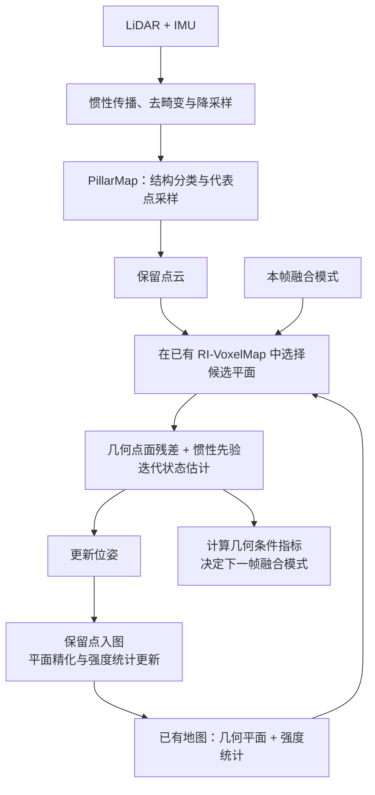

下面按**当前代码的实际执行顺序、输入输出和核心判据**整理。范围是静态 PillarMap、plane refinement 和 intensity fusion；不包含 dyn，也不包含当前实验配置未启用的强度关联门、在线强度噪声估计与入射角补偿。

首先需要区分：**PillarMap 在配准前筛选观测；intensity fusion 在配准中选择对应；plane refinement 在建图与地图更新时维护平面。** 三者通过跨帧地图连接起来。

**一、系统总体 pipeline**

首帧是特例：PillarMap 筛选后，先初始化地图，再进入状态估计。总体入口见 [LIVMapper::handleLIO](/home/wsl-2004-5090/code/voxel-pillar/catkin_ws/src/Voxel-Pillar/src/LIVMapper.cpp:373)。

---

**二、PillarMap：基于局部空间拓扑与分层采样的柱状体素观测筛选**

**输入：** 降采样后的当前帧点云、传播位姿、近期体素占据历史。  
**输出：** 结构标签、实际保留点集合；保留点同时参与配准和地图更新。

其完整流程为：

> **构建柱状体素 → 更新占据历史 → 生成结构候选 → 邻域支持确认 → 冗余体素分层采样 → 生成删除掩码 → 压缩点云。**

**步骤 1：构建柱状体素表示**

将当前帧点转换到世界坐标系，按体素尺寸 \(s\) 离散：

\[
\mathbf v(\mathbf q)=\left\lfloor\frac{\mathbf q}{s}\right\rfloor .
\]

相同水平索引 \((v_x,v_y)\) 的体素归入同一柱，柱内按高度索引 \(v_z\) 排序。

每个体素保存：

- 点数 \(N_v\)；
- 点集质心 \(\mathbf c_v\)；
- 原始点索引。

这使后续判别能够同时访问**柱内垂直关系**和**跨柱邻接关系**。实现见 [BuildPillarMap](/home/wsl-2004-5090/code/voxel-pillar/catkin_ws/src/Voxel-Pillar/src/voxel_map.cpp:1714)。

**步骤 2：更新近期占据历史**

记录有限窗口内出现过的体素索引，用于补充当前帧缺失的占据支持。

当前代码先更新历史，再进行静态结构分类，因此窗口包含当前帧。**当前 SubT 配置中 `pillar_buffer=1`，没有更早帧的历史支持**；论文应区分"具备历史机制"和"实验配置实际使用历史"。

**步骤 3：生成三类结构候选**

| 类别 | 柱内候选条件 |
|---|---|
| 水平冗余 | 柱中最低占据体素；点数较多；紧邻上层在当前观测和历史中均无占据 |
| 垂直冗余 | 柱内中间体素；上下紧邻层均被占据；当前体素点数较多 |
| 孤立 | 非底部稀疏体素；与下方占据层存在空层，内部体素还要求上方存在空层；相关间隔没有历史占据支持 |

注意两个判据细节：

- 水平冗余的"紧邻上层"判据在当前帧与历史中**不对称**：当前帧要求次层高度索引差 \(\geq 2\)（即中心距 \(\geq 2s\)），历史中则是精确索引 \(v_z+1\) 一旦出现过即视为有紧邻上层。
- 水平候选（底部 + 无紧邻上层）与垂直候选（上下均被紧邻层夹住）在构造上**互斥**；确认失败的候选降级为普通点，而不是直接删除。

这里的"水平、垂直"是依据占据结构作出的分类，**没有通过平面法向估计严格判定表面朝向**。

**步骤 4：利用跨柱邻域确认类别**

邻域按水平环组织：ring 1 为 4 个面邻接柱（距离 1），ring 2 为 4 个对角柱（距离 \(\sqrt 2\)），两者不相交。`neighbor_ring_num=1` 时只探测 ring 1（4 柱）；为 2 时依次探测 ring 1 与 ring 2，完整邻域为 **4 邻接 + 4 对角共 8 柱**（水平 8 邻域），两环共享支持计数并提前退出。

水平冗余使用同高度层邻居。当前存在的邻居须满足：

\[
|c_{z,v'}-c_{z,v}|
\leq s\,\gamma_h ,
\]

其中 \(\gamma_h\) 为高度一致性比例。满足条件的支持数达到阈值后，确认水平冗余。

垂直冗余使用同一水平环在 \(z-1\)、\(z+1\) 两层的移位：`neighbor_ring_num=1` 时共 8 个候选槽位，为 2 时 16 个。槽位占据由相邻柱高度索引的精确匹配判定（柱顶、柱底与孤立空隙因此天然为空槽），**不使用同层高度一致性门限**；支持数在两层与两个环之间共享累计，达到阈值即早退确认。

孤立候选在同层邻域中缺乏足够支持时确认。当前缺失的邻居可以由近期占据补充；当前存在但高度不一致的邻居不能被历史覆盖。

具体判别见 [updatePillarFlag 与邻域检查](/home/wsl-2004-5090/code/voxel-pillar/catkin_ws/src/Voxel-Pillar/src/voxel_map.cpp:1579)。

**步骤 5：为冗余体素确定保留预算**

采样开启时，对水平、垂直两类冗余体素分别处理。该方法定名 **PRISM**（Pillar-guided Redundancy-aware Intra-voxel Stratified sampling）。含 \(N_v\) 个点的体素保留：

\[
M_v=
\min\!\left(
N_v,\,
\max\left(M_{\min},\left\lceil\alpha N_v\right\rceil\right)
\right).
\]

其中：

- \(\alpha\)：目标保留比例；
- \(M_{\min}\)：最少保留点数。

因此当前 SubT 的比例 \(0.2\) 并不表示每个体素都恰好保留 20%。例如 \(N_v=20\)、\(M_{\min}=10\)，实际保留 10 个点。

**步骤 6：径向分层与配额分配**

计算点到体素质心的距离：

\[
r_i=\|\mathbf q_i-\mathbf c_v\|,
\qquad
b_i=\left\lfloor r_i/\Delta r\right\rfloor .
\]

按固定径向宽度 \(\Delta r\) 划分壳层，再向尚未达到容量的非空壳层轮流分配名额，直到分配完 \(M_v\)。

**与 GFH（RMS 梯度流启发式）的关系：**邻域限制在本体素内时，梯度流特征解析退化为质心距离：

\[
\|\boldsymbol{\Delta}_i\|
=\frac{N_v}{N_v-1}\,\|\mathbf c_v-\mathbf q_i\|
=\frac{N_v}{N_v-1}\,r_i,
\]

其熵均衡区间采样退化为径向壳层配额采样。即 PRISM 是 GFH 在体素邻域约束下的精确（退化）形态；改用 \(\lambda\)-ball 邻域则还原其完整语义，两者构成单变量（邻域定义）消融。

这里的"分层"指**围绕质心的径向壳层**，不是八叉树层级，也不是高度分层。

**步骤 7：壳层内最远点采样**

每个壳层首先选择距体素质心最远的点作为种子，再依次选择与已选集合最分离的点：

\[
p^\star=
\arg\max_{p\in B_b\setminus S_b}
\min_{s\in S_b}\|p-s\|^2 .
\]

直到达到该壳层配额。其设计目的是在减少点数时兼顾不同径向位置和层内空间覆盖，不直接保证位姿信息最优。

实现见 [sampleRedundantVoxels](/home/wsl-2004-5090/code/voxel-pillar/catkin_ws/src/Voxel-Pillar/src/voxel_map.cpp:2183)。

**步骤 8：生成实际保留集合**

- 冗余采样开启：由采样掩码决定冗余点的保留，覆盖 `delete_redundant`。
- 冗余采样关闭：由 `delete_redundant` 决定该类是否删除。
- 孤立点：由 `delete_isolated` 决定。
- 普通点：静态筛选下保留。

随后同步压缩传感器系和世界系点云，保证索引对应。被删除点既不参与本帧配准，也不进入后续地图。

该筛选**没有跨帧反馈回路**：删除只作用于当前帧点云，下一帧柱状体素从原始扫描独立重建，体素点数门限不受历史采样的影响。

**论文中可概括为：**

> 通过局部占据拓扑识别冗余与孤立结构，在冗余区域内采用径向分层配额和最远点采样选择代表观测（PRISM），实现结构判别与观测压缩的联合处理。

---

**三、Plane refinement：基于空间支撑检验与增量一致性的平面维护**

**输入：** 体素内积累的支撑点，或位姿更新后插入地图的新点。  
**输出：** 有效概率平面、细分后的子体素，或被拒绝的插入观测。

这个模块应画成**初始化与增量更新两条流程**。

**流程 A：初始平面建立**

> **积累足够点 → 初始 PCA → 距离筛选 → 重新拟合 → 条件执行投影连通性检查 → 最终拟合与平面性判定 → 接受平面或继续细分。**

**步骤 A1：初始 PCA**

对体素点集计算：

\[
\mathbf c=\frac1N\sum_i\mathbf q_i,
\qquad
\mathbf C=\frac1N\sum_i
(\mathbf q_i-\mathbf c)(\mathbf q_i-\mathbf c)^\top .
\]

最小特征值对应的特征向量作为初始法向 \(\mathbf n_0\)。

**步骤 A2：删除距离不一致的支撑点**

保留满足以下条件的点：

\[
|\mathbf n_0^\top(\mathbf q_i-\mathbf c_0)|
\leq\tau_d .
\]

随后重新进行 PCA。保留点少于 3 个时，不能建立有效平面。

**步骤 A3：检验平面内空间连通性**

当层级、点数和开关条件满足时：

1. 将支撑点投影到平面的两个切向轴；
2. 离散为二维网格；
3. 提取四连通分量；
4. 按包含的点数选择最大分量。

仅当

\[
\frac{N_{\max}}{N_{\mathrm{support}}}>\tau_c
\]

时接受该支撑分量并删除其他分量，随后对保留分量再次拟合；否则将体素判为非平面。

该步骤检查的是支撑点分布是否足够集中、连通，不能仅凭连通性证明点属于同一个物理表面。

**步骤 A4：最终拟合与模型输出**

对最终支撑集重拟合，要求：

\[
\lambda_{\min}(\mathbf C)<\tau_p .
\]

接受后保存中心、法向、支撑半径及平面参数协方差 \(\Sigma_\pi\)。协方差由单点测量协方差传播而来，逐点累加：

\[
\Sigma_\pi \leftarrow \Sigma_\pi+
\mathbf J\,\Sigma_q\,\mathbf J^\top ,
\qquad
\mathbf J=
\begin{bmatrix}
\mathbf E\,\mathbf F\\
\tfrac1N\mathbf I
\end{bmatrix},
\]

其中 \(\mathbf E\) 为特征向量矩阵，\(\mathbf F\) 为特征值对点位置的敏感度矩阵，下块为中心敏感度；每次重拟合后重新累计。

其中：

- \(\mathbf C\)：支撑点坐标分布的协方差；
- \(\Sigma_\pi\)：平面参数的不确定性。

不满足平面条件时，在最大深度允许范围内继续细分。当前实现删除的支撑点不会进入完整的离群点复用流程。

实现见 [init_plane](/home/wsl-2004-5090/code/voxel-pillar/catkin_ws/src/Voxel-Pillar/src/voxel_map.cpp:160) 和 [plane_valid_check](/home/wsl-2004-5090/code/voxel-pillar/catkin_ws/src/Voxel-Pillar/src/voxel_map.cpp:406)。

**流程 B：增量平面维护**

> **新点进入已有平面体素 → 计算试插入统计 → 检查平面性 → 接受或拒绝 → 更新几何与强度统计 → 周期重拟合。**

设已有点数为 \(N\)，中心为 \(\mathbf c\)，二阶统计为

\[
\mathbf Q=\sum_i\mathbf q_i\mathbf q_i^\top .
\]

新点 \(\mathbf q\) 的试插入结果为：

\[
\mathbf c'=\frac{N\mathbf c+\mathbf q}{N+1},
\]

\[
\mathbf Q'=\mathbf Q+\mathbf q\mathbf q^\top,
\qquad
\mathbf C'=\frac{\mathbf Q'}{N+1}-\mathbf c'\mathbf c'^\top .
\]

当 \(\lambda_{\min}(\mathbf C')<\tau_p\) 时接受；否则拒绝该点。检验采用固定大小矩阵，不需要遍历全部历史支撑点。

当前实现还有四个边界：

- 支撑点少于 5 个时，暂不执行该拒绝判定。
- 检验仅作用于仍允许几何更新的平面。
- 几何更新冻结后，强度 EMA 仍可继续更新。
- 接受的新点会立即更新中心、法向等平面参数，但 \(\Sigma_\pi\) 的刷新被**推迟到下一次重拟合**；因此两次重拟合之间，下游关联使用的平面不确定性略滞后于当前平面参数。

几何更新开启时，被拒绝的点会在强度更新之前返回。这是 refine 与 intensity 的直接联系。实现见 [check_and_update](/home/wsl-2004-5090/code/voxel-pillar/catkin_ws/src/Voxel-Pillar/src/voxel_map.cpp:374) 和 [UpdateOctoTree](/home/wsl-2004-5090/code/voxel-pillar/catkin_ws/src/Voxel-Pillar/src/voxel_map.cpp:576)。

**论文中可概括为：**

> 在平面建立阶段验证支撑点的几何一致性与空间连通性，在增量更新阶段检验新观测对平面性的影响，将模型有效性检查贯穿地图维护过程。

该部分须保留代码中注明的 R-VoxelMap 技术来源。

---

**四、Intensity fusion：退化感知的几何—强度联合平面选择**

**输入：** 当前迭代位姿下的保留点、已有概率平面及强度统计、本帧融合模式。  
**输出：** 每个有效点的对应平面，以及用于下一帧的融合状态。

可以拆成**统计维护、候选生成与选择、条件反馈**三个子流程。

**流程 A：维护平面级强度统计**

平面首次初始化时，计算支撑点的原始强度均值和方差。后续观测采用 EMA：

\[
\delta_I=I-\mu_I,
\]

\[
\mu_I^+=\mu_I+\alpha_I\delta_I,
\qquad
v_I^+=(1-\alpha_I)v_I+\alpha_I\delta_I^2 .
\]

其中 \(I\) 为原始强度。几何周期重拟合不重置已有 EMA 历史，首次批初始化也只发生一次。

**流程 B：候选生成与选择**

> **点变换与不确定性传播 → 根体素查找 → 八叉树候选遍历 → 几何门限 → 按本帧模式评分 → 选择平面 → 构建几何残差。**

**步骤 B0：候选生成**

根体素按基线的量化规则定位（浮点商、负坐标先减 1 再截断，**与 PillarMap 的 floor 量化不同**）。匹配自第 0 层开始：根体素自身是平面时直接参与评分；否则沿八叉树向深层下潜，深度不超过 \(L_{\max}\) 的所有平面节点均为候选，各自独立通过几何门限并评分，全局评分最高者胜出，命中的层号随观测记录。体素未分裂时，残差直接来自根平面。

**步骤 B1：几何候选检验**

对查询点 \(\mathbf q\) 和平面 \((\mathbf c,\mathbf n)\)，计算：

\[
r_g=\mathbf n^\top(\mathbf q-\mathbf c),
\]

\[
s_g^2=
J_\pi\Sigma_\pi J_\pi^\top+
\mathbf n^\top\Sigma_q\mathbf n,
\qquad
J_\pi=[(\mathbf q-\mathbf c)^\top,-\mathbf n^\top].
\]

候选须同时满足：

- 点在平面内的投影位置没有超出支撑范围，当前上限为平面半径的 3 倍；
- \(|r_g|<k_gs_g\)。

**步骤 B2：计算强度一致性**

\[
r_I=I-\mu_I ,
\qquad
s_I^2=\max(v_I,\,\epsilon_I),
\]

其中 \(\epsilon_I\) 为防止方差塌缩的下限。

**步骤 B3：按本帧模式评分**

融合启用时：

\[
S_{GI}=
\exp\left[
-(1-w_I)\frac{r_g^2}{s_g^2}
-w_I\frac{r_I^2}{s_I^2}
\right].
\]

融合未启用时：

\[
S_G=
\frac1{s_g}
\exp\left[-\frac{r_g^2}{2s_g^2}\right].
\]

在当前搜索范围内选择评分最大的有效候选。根体素存在但没有可接受候选时，按当前位置规则检查邻居；根不存在时，当前实现不会自动执行该邻居回退。

**步骤 B4：输出几何观测**

选定平面后，输出点面残差、法向、中心及不确定性，供 IESKF 更新。

强度影响"选择哪个平面"，**不向滤波器添加强度残差或强度雅可比**。候选选择发生在每次实际迭代中，随位姿更新重新执行。

实现见 [BuildResidualListOMP](/home/wsl-2004-5090/code/voxel-pillar/catkin_ws/src/Voxel-Pillar/src/voxel_map.cpp:1115) 和 [build_single_residual](/home/wsl-2004-5090/code/voxel-pillar/catkin_ws/src/Voxel-Pillar/src/voxel_map.cpp:1217)。

**流程 C：计算几何条件并更新下一帧模式**

由本次匹配的几何观测构造观测信息矩阵的 \(6\times6\) 位姿块：

\[
\Lambda=\sum_iJ_i^\top V_i^{-1}J_i,
\qquad
\eta=\frac{\lambda_{\min}(\Lambda)}
{\lambda_{\max}(\Lambda)} .
\]

这里 \(V_i\) 是滤波器观测方差，在 \(s_g^2\) 的两项之外附加 \(10^{-3}\) 的正则底噪，与关联评分使用的 \(s_g^2\) 不同。\(\Lambda\) 在每次迭代都计算（含 \(\lambda_{\max}\) 过小的保护），状态机只消费**最后一次迭代**留下的条件指标。

帧末推进状态机：

- 连续 \(K\) 帧低于启用阈值：启用融合。
- 连续 \(K\) 帧高于退出阈值：关闭融合。
- 位于两个阈值之间：保持模式，并清零连续计数。

**结果作用于下一帧，本帧内的融合模式保持不变。** 若关闭自适应机制而开启强度融合，则始终使用融合评分。

该指标反映固定姿态—平移参数化下的几何条件，不是完整系统可观测性证明。实现见 [StateEstimation](/home/wsl-2004-5090/code/voxel-pillar/catkin_ws/src/Voxel-Pillar/src/voxel_map.cpp:729)。

**论文中可概括为：**

> 在几何有效候选中，以平面级强度统计辅助对应判别，并通过几何条件反馈与滞回机制控制融合模式，使候选选择策略随场景几何条件调整。

---

**五、实验参数对照表**

| 符号 | 含义 | 配置键 | SubT 值 |
|---|---|---|---|
| \(s\) | 体素/柱宽 | lio/voxel_size、pillar_map/voxel_size | 0.5 |
| \(L_{\max}\) | 八叉树最大层 | lio/max_layer | 1 |
| \(N_{\mathrm{th}}\) | 冗余/孤立点数门限 | pillar_map/min_num | 10 |
| \(\gamma_h\) | 高度一致性比例 | pillar_map/height_consistency_ratio | 0.5 |
| ring | 邻域环数 | pillar_map/neighbor_ring_num | 1 |
| \(\theta_h\) / \(\theta_v\) | 水平/垂直确认阈值 | horizontal/vertical_redundant_threshold | 4 / 2 |
| \(\alpha\) / \(M_{\min}\) / \(\Delta r\) | 采样比例 / 下限 / 壳层宽 | redundant_sample_ratio、min_pts、bin | 0.2 / 10 / 0.1 |
| \(n_{\mathrm{buf}}\) | 占据历史窗口 | pillar_map/pillar_buffer | 1 |
| \(\tau_d\) | 首拟合离群距离 | lio/init_distance_threshold | 0.1 |
| \(\tau_p\) | 平面性特征值阈值 | lio/min_eigen_value | 0.0025 |
| 守卫参数组 | 层级/点数/分辨率/占比 | plane_valid_check_en、valid_check_* | on / 0 / 10 / 4 / 0.6 |
| \(k_g\) | 几何门 | lio/sigma_num | 3 |
| \(w_I\) | 强度融合权重 | lio/intensity_fusion_weight | 0.5 |
| \(\alpha_I\) | 强度 EMA 步长 | lio/intensity_ema_alpha | 0.05 |
| on / off / \(K\) | 退化状态机 | degeneracy_on/off_threshold、min_frames | 0.005 / 0.1 / 1 |
| — | 迭代次数 | lio/max_iterations | 5 |
